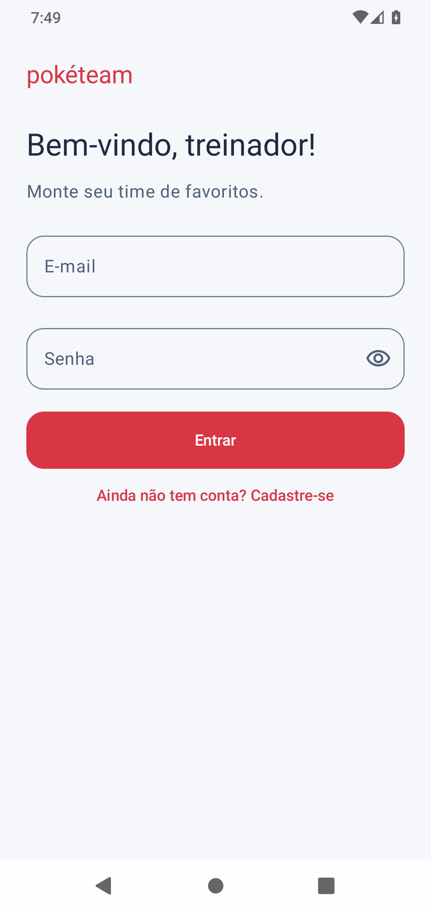
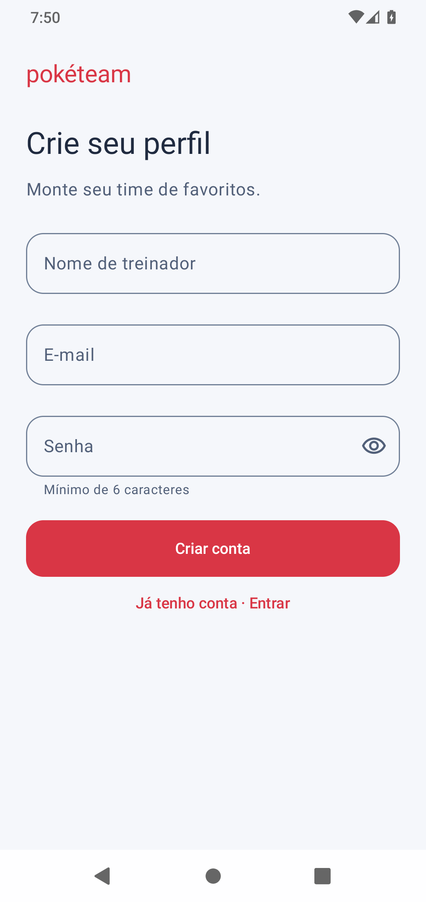
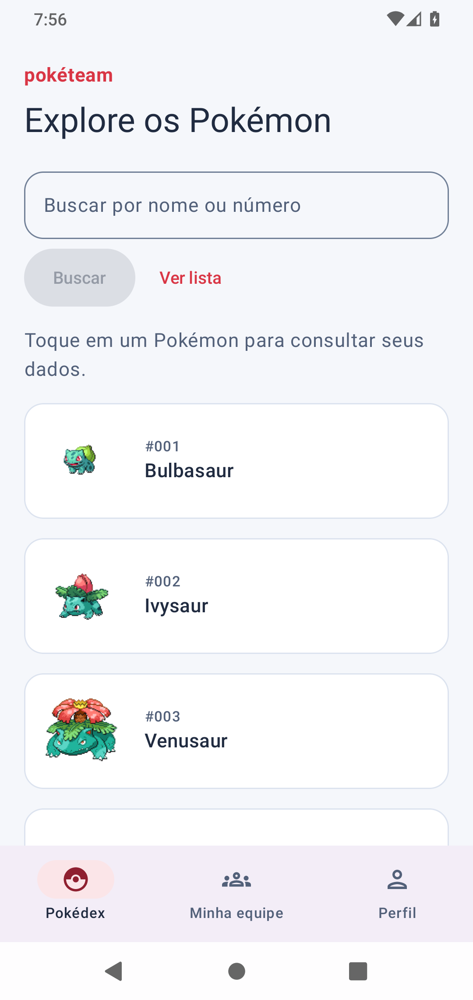
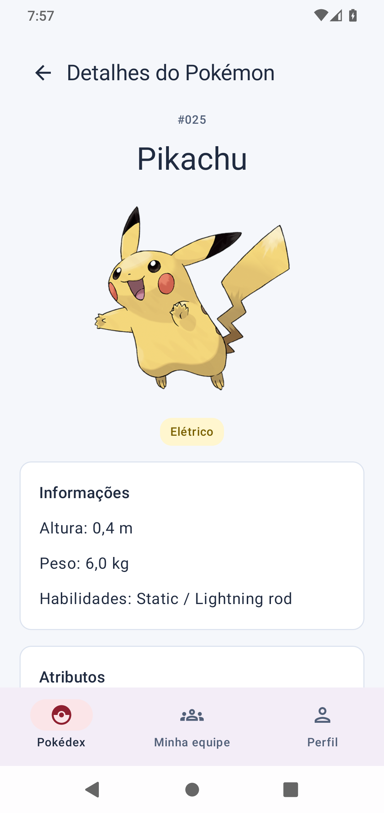
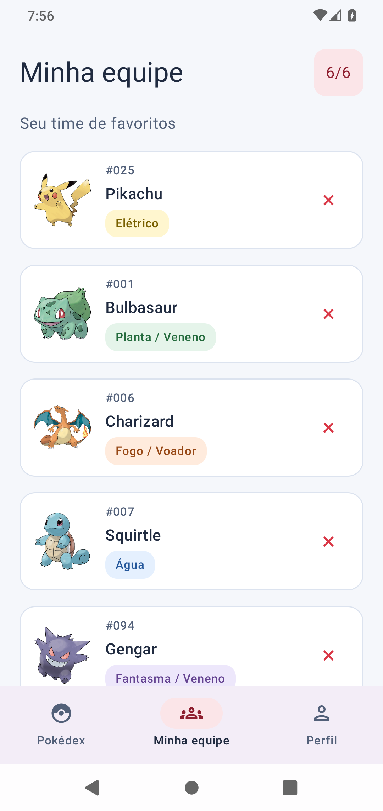
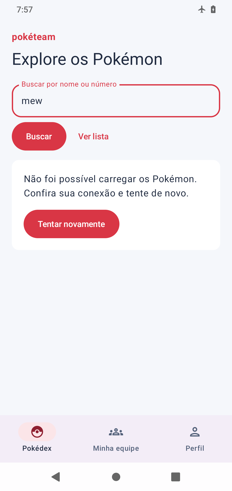

# PokeTeam

Aplicativo Android em Kotlin para o usuário montar e salvar sua equipe favorita de até seis Pokémon.

## Funcionalidades

- Cadastro e login locais com e-mail único, validação dos campos e senha protegida por PBKDF2 com salt individual.
- Sessão mantida ao fechar e reabrir o aplicativo, com opção de sair da conta.
- Pokédex com os primeiros 20 Pokémon e busca por nome ou número em toda a PokéAPI.
- Detalhes com imagem, tipos, altura, peso, habilidades e atributos.
- Equipe com um a seis Pokémon, sem repetidos, com remoção e indicação das vagas disponíveis.
- Botão para salvar a equipe no perfil; alterações permanecem como rascunho até salvar.
- Confirmação para salvar, descartar ou continuar editando ao sair com alterações.
- Banco Room com os dados separados por usuário; equipe e perfil podem ser consultados sem conexão.
- Três abas: **Pokédex**, **Minha equipe** e **Perfil**; tela de detalhes com rota tipada.
- Estados de carregamento e erro, com opção de tentar novamente.

O login e os dados são locais no aparelho. Não há sincronização de contas entre dispositivos. Uma equipe vazia não pode ser salva; o rascunho não salvo é mantido durante a sessão e descartado se o processo do aplicativo for encerrado pelo sistema.

## API utilizada

[PokéAPI](https://pokeapi.co/docs/v2), sem chave de acesso.

- Base: `https://pokeapi.co/api/v2/`
- `GET pokemon?limit=20`: lista inicial.
- `GET pokemon/{nomeOuNumero}`: identificação, imagens, tipos, medidas, habilidades e atributos.

As consultas usam Retrofit e coroutines. O Repository mantém cache em memória para evitar consultas repetidas; as imagens são carregadas com Coil.

## Prints

Capturas reais do aplicativo em um emulador Android. As contas e equipes mostradas são de demonstração.

<p>
  
  
  
</p>
<p>
  
  
  
</p>

[Ver também o perfil com a equipe salva](docs/screenshots/perfil.png).

## Executar no Android Studio

1. Clone este repositório e abra a pasta que contém `settings.gradle.kts`.
2. Aguarde a sincronização do Gradle. Use JDK 17 e instale o Android SDK 35 e Build Tools 35.0.0 quando solicitado.
3. Selecione um emulador ou conecte um celular com Android 7.0/API 24 ou superior, com depuração USB habilitada.
4. Execute o módulo `app`. Crie uma conta na tela inicial para começar.

Também é possível editar pelo VS Code e compilar pelo terminal, com Java e Android SDK configurados:

```sh
./gradlew assembleDebug
```

Configure o SDK em `local.properties` (`sdk.dir=/caminho/do/Android/sdk`) ou na variável `ANDROID_HOME`. O arquivo `local.properties` é específico de cada computador e não deve ser enviado ao GitHub.

APK de teste: `app/build/outputs/apk/debug/app-debug.apk`.

## Organização do código

- `network`: interface e instância do Retrofit.
- `data`: modelos da API, entidades e DAOs Room, banco, repositories, proteção de senhas e sessão.
- `viewmodel`: estado e operações de acesso, busca, detalhes e edição da equipe.
- `userinterface`: telas Compose, tema, navegação e MainActivity.

As telas chamam os ViewModels. Os repositories concentram as operações de rede, banco e autenticação. O schema do banco está em `app/schemas`.

## Testes e conferência

```sh
./gradlew testDebugUnitTest lintDebug assembleDebug
./gradlew connectedDebugAndroidTest
```

O último comando exige um emulador iniciado ou celular conectado. Os testes cobrem consumo e leitura do JSON, cache, cancelamento, validação de cadastro e login, hash de senha, limites da equipe, rascunho, isolamento por usuário, transações e persistência da sessão e do banco.

Validação executada em 03/11/2026: APK compilado, análise Android Lint sem erros, **29 testes unitários e 5 instrumentados aprovados** em emulador Android 11/API 30. O fluxo completo também foi percorrido na interface, incluindo modo avião, troca de contas, restauração após encerrar o processo e confirmação de alterações ao sair.

Roteiro para conferir o fluxo completo:

1. Crie uma conta. Confira os erros de e-mail inválido, senha curta e e-mail já cadastrado.
2. Tente entrar com senha incorreta; depois entre corretamente.
3. Busque `pikachu` ou `25`, abra o detalhe e adicione à equipe.
4. Monte até seis Pokémon e confira que não é possível repetir um Pokémon nem adicionar um sétimo.
5. Na aba **Minha equipe**, salve. Confira a equipe na aba **Perfil**.
6. Remova um Pokémon e abra o perfil: ele continua mostrando a última equipe salva até salvar novamente.
7. Saia com alterações e confira as opções de salvar, descartar ou continuar editando.
8. Feche e reabra: a sessão e a equipe salva devem continuar disponíveis.
9. Desligue a internet e consulte um Pokémon ainda não carregado para conferir o erro. Equipe e perfil continuam acessíveis. Religue a internet e tente novamente.
10. Saia e entre com outra conta: as equipes não devem se misturar.

## Divisão de tarefas

| Integrante | O que fez |
|------------|-----------|
| Gustavo Azevedo | A preencher pelo grupo. |
| Eduardo Aquino | A preencher pelo grupo. |
| Giovanni Trivellato | A preencher pelo grupo. |

A divisão efetivamente realizada deve ser registrada pelos integrantes antes da entrega. Cada pessoa deve revisar sua parte, conseguir explicá-la na apresentação e realizar seus próprios commits.

## O que aprendemos

- **Gustavo Azevedo:** a preencher pelo integrante com suas próprias palavras.
- **Eduardo Aquino:** a preencher pelo integrante com suas próprias palavras.
- **Giovanni Trivellato:** a preencher pelo integrante com suas próprias palavras.

Cada integrante também deve preencher individualmente o formulário de feedback do enunciado.

## Referências

- [Arquitetura em pacotes](https://rclepf.github.io/ArquiteturaPacotesAndroid/)
- [Consumo de API no Android](https://rclepf.github.io/PokedexApiAndroid/)
- [Persistência local](https://rclepf.github.io/PersistenciaAndroid/) e [Room](https://rclepf.github.io/RoomAndroid/)
- [Projeto SQLiteAndroid](https://github.com/trvzera/SQLiteAndroid)
